# Computational Engineering Portfolio

**Generation and analysis of physical models through computer algorithms.**

This repository demonstrates computational engineering: using software to define, generate, and analyze physical objects and their behavior. Rather than drawing shapes manually in CAD software, geometry is defined programmatically through mathematical functions and parameters, enabling precise control, reproducibility, and design exploration.

The package lives under `src/pysurf/`. It follows the layout of the NOVA nozzle suite: a facade class for each domain, and single-purpose shared modules (geometry, figures, units, errors, validation, export) that every domain calls rather than reimplementing.

---

## Domains

### Surfboard

Parametric surfboard geometry built from the three views a shaper works from: the planform (top-down outline), the rocker (side profile of deck and bottom), and the cross section with its rails. The planform and both rockers are C1-continuous cubic Bezier sections with controllable departure, arrival, and midpoint angles, overlaid on reference photographs of a thruster for comparison. Each cross section spans the planform's half-width and the rockers' thickness at its station: a deck contour and a bottom contour meet at the rail apex, halfway up the local thickness, each following $(z/b)^2 + |y/a|^p = 1$ from the apex, elliptic where it turns vertical at the rail and flatter across the board the larger $p$. The deck and bottom exponents vary along the board and are fitted to the sections of the reference thruster's STL. Scaled to each station's half-width and thickness, the generated sections lie within 0.9% of the local thickness (rms) of the STL's from 0.2 to 0.9 of the length, and within 2.0% toward the tips; elliptical sections miss them by 5 to 7%. That is a calibration to the board the exponents came from, not a validation. `exportGeometry` writes the board as one closed, outward-facing STL surface; [generatedThruster.stl](assets/surfboard/generatedThruster.stl) is the default board at 240 stations and 33 points per contour, 2198 in³ (36.0 L), the same volume the sections integrate to within 0.05%.

```python
from pysurf import Surfboard

board = Surfboard(totalLength = 6.0, maxWidth = 20.0, midpointThickness = 2.5,
                  noseShape = 'point', tailShape = 'round', rockerProfile = 'aggressive')
board.plotsEnabled = True
board.generateGeometry()
board.exportGeometry('board.stl')            # closed surface, in inches by default
```

Length is in feet; width and thickness are in inches.

### Breaking Wave

Breaking surf waves in 2D over a bed of any shape: a wave shoaling up a beach until it breaks onto the shore, and swell breaking in open water where a reef rises steeply under it. Three models cover it, each answering a different question.

- `OverturningWave` solves fully nonlinear potential flow with boundary elements. Its free surface can fold, so it gives the shape of the barrel: the lip curling over and the tube under it, up to the moment the jet lands. `SplashUp` hands that flow to particles and carries it on through the impact and the splash-up; `ReefOverturn` feeds it waves from an SGN train breaking on a reef.
- `SurfaceBreakingWave` and `ReefBreak` solve the Serre-Green-Naghdi equations for the free surface. The surface cannot fold, so a breaking wave becomes a bore, but where and how high waves break comes out in about a minute, for a single wave on a beach or a train of swell over a reef.
- `BreakingWave` simulates every parcel of water as a particle with weakly compressible SPH on a GPU. Its δ-SPH scheme reaches Grilli's breaking point from 64 particles per depth and the DNS's overturn at 128, and carries the water on through the jet's landing, where it dissipates too little. `BreakingWave3D` runs the same scheme over a 3D bed met from any direction.

Grilli et al.'s (1997) slope parameter $S_0 = 1.521 \tan\beta / \sqrt{H/d}$ predicts the breaker type before anything runs. The runs are Froude-similar, so every result scales with the depth $d$ and every time with $\sqrt{d/g}$. The GIFs show the whole bed above, its vertical scale stretched, and a true-scale close-up below; the red marker is the measured breaking point.

| | Potential flow (BEM) | Free surface (SGN) | Particles (SPH) |
| --- | --- | --- | --- |
| Unknowns, 1:35 case | 440 to 570 surface and 224 bed nodes | Depth and depth-averaged velocity on 3,869 cells | 128,947 particles, 64 per depth |
| Run time, 1:35 case | 8 min | 70 s | 11 min on a GPU |
| Breaking point vs Grilli (1997) | $H_b/d$ +5.8%, $h_b/d$ +4.1% | $H_b/d$ -4.5%, $h_b/d$ +2.0% | $H_b/d$ +4.3%, $h_b/d$ -8.4% |
| Overturn shape at impact vs DNS and field | $A_O/H_I^2$ -0.9%, $\theta_O$ -3.0°; $W/L$ +1.3% vs field | None: the front becomes a bore | $A_O/H_I^2$ -3%, $\theta_O$ -3.6° vs DNS, at 128 particles per depth |
| Overturning lip | Yes, until the jet lands | No: the front becomes a bore | Yes, through the jet's landing |
| After breaking | Ends at touchdown; `SplashUp` carries it on with SPH | Bore and runup | Splash, bore and runup; dissipates too little |
| Breaking criterion | Front face vertical (Grilli's definition) | Front steeper than 30 degrees (Tissier et al. 2012) | Front face vertical: the start of its last vertical run before the jet lands |

#### Free-surface model (Serre-Green-Naghdi)

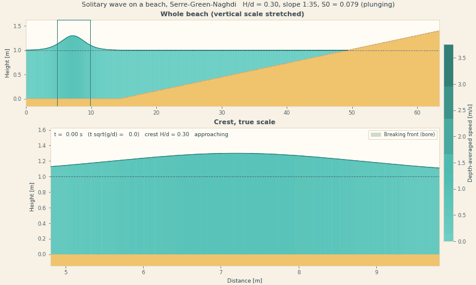

```python
from pysurf.SurfaceBreakingWave import SurfaceBreakingWave

wave = SurfaceBreakingWave(depth = 1.0, waveHeight = 0.3, beachSlope = 1 / 35, cellsPerDepth = 50)
wave.run()
wave.summary()                               # breaking point, breaker type
wave.writeAnimation('surfaceWave.gif')
```

The Serre-Green-Naghdi (SGN) equations keep the full nonlinearity of the shallow-water equations and add the pressure that the vertical acceleration of the water column carries, which gives the waves dispersion. `sgnSolver` splits them in two (Bonneton et al. 2011): the shallow-water part as finite volumes with the hydrostatic reconstruction of Audusse et al. (2004), which holds a lake at rest exactly and lets the water run up a dry beach, and the dispersive part as a tridiagonal solve for the extra acceleration. The wave starts as the exact SGN solitary wave. When its front passes 30 degrees, the dispersive part is switched off over a zone 2.5 roller lengths wide around the front (Tissier et al. 2012), and the shallow-water equations carry the front as a bore, which dissipates energy as a hydraulic jump does. The water is drawn as columns from the bed to the surface, colored by depth-averaged speed and whitened where the wave is breaking.

| Quantity | Reference | Reference value | Model value | Error | Verdict |
| --- | --- | --- | --- | --- | --- |
| Breaking height $H_b/d$, $H/d = 0.3$, slope 1:35, 50 cells per depth | Grilli et al. (1997) | 0.476 | 0.454 | -4.5% | Pass (10%) |
| Breaking depth $h_b/d$ | Grilli et al. (1997) | 0.345 | 0.352 | +2.0% | Pass (15%) |
| Breaking index $H_b/h_b$ | Grilli et al. (1997) | 1.380 | 1.291 | -6.5% | |
| Non-breaking runup $R/d$, $H/d = 0.019$, slope 1:19.85 | Synolakis (1987) | 0.0890 | 0.0874 | -1.8% | Pass (10%) |
| Exact SGN solitary wave, height and speed after 7 depths, 40 cells per depth | Closed form | | | < 0.01% | Pass, second order |
| Standing wave period at $kd = 1$ | SGN linear dispersion | | | < 0.01% | Pass |
| Dam break onto a dry bed | Ritter (1892) | | | 0.12% (L1) | Pass, first order |

The breaking criteria are the published values, not tuned to Grilli: Tissier et al. took the 30-degree angle from Cienfuegos et al.'s (2010) fit to laboratory breaking. The breaking point is converged in resolution: $H_b/d$ is 0.452, 0.454 and 0.455 at 25, 50 and 100 cells per depth. The criterion is the sensitivity. Grilli's breaking point is where the face turns vertical, which a single-valued surface cannot reach, and a 25- or 35-degree angle moves $h_b/d$ to 0.390 or 0.321. Not validated: the bore after breaking, and the runup of a breaking wave. The runup tongue has no bed friction, so it climbs as a sheet millimeters thick and still moving fast when the run ends; the runup the summary reports for a breaking wave is not a measurement.

#### Overturning (boundary element potential flow)

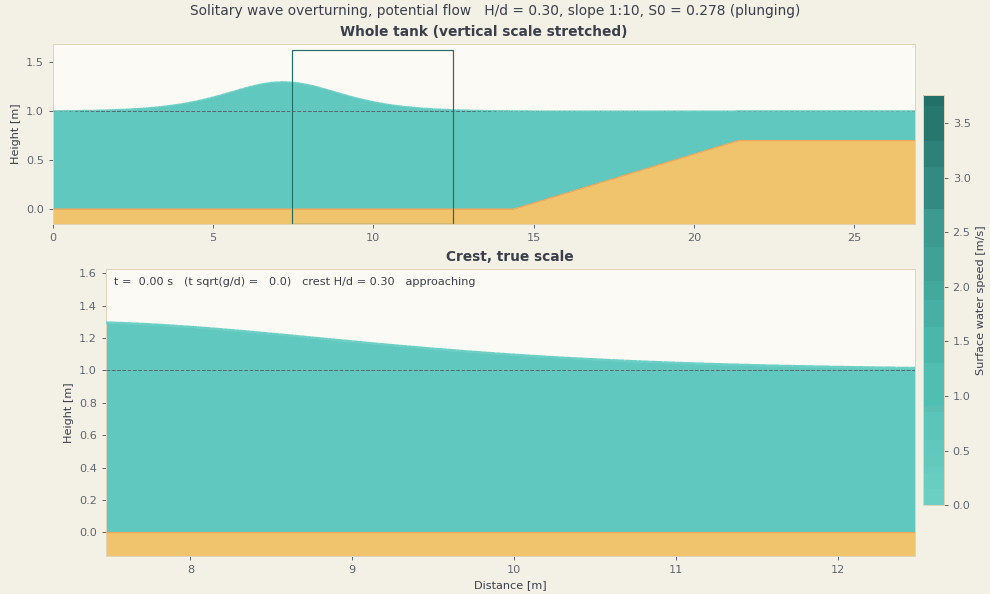

```python
from pysurf.bathymetry import Bathymetry
from pysurf.OverturningWave import OverturningWave

reef = Bathymetry.reefBreak(depth = 1.0, toeX = 14.4, faceSlope = 0.1, reefDepth = 0.3, reefLength = 8.0)
wave = OverturningWave(depth = 1.0, waveHeight = 0.3, bathymetry = reef, beachSlope = 0.1)
wave.run()
wave.summary()                               # breaking point; tube and overturn measures at impact
wave.drawProfiles()                          # the overturn as a sequence of profiles
wave.drawOverturn()                          # the overturn at impact with its fitted curve
wave.writeAnimation('overturningWave.gif')
```

The water is inviscid and irrotational, so `bemSolver` solves Laplace's equation on the boundary alone: the free surface, the bed and a wall at each end. The boundary is cut into straight elements whose integrals have closed forms, so there is no quadrature error however close the jet comes to the water below. The free-surface nodes move with the water and carry the potential from the zero-pressure surface condition, stepped with fourth-order Runge-Kutta; once the face overhangs, no node moves more than half a spacing in a step. Because the nodes move with the water, the surface can fold into a jet. They are regridded finer around the crest, wherever the surface curves sharply, and wherever it folds back over itself, as the face does under a landing jet, and smoothed with Longuet-Higgins and Cokelet's five-point filter against the sawtooth that grows on a Lagrangian surface. The run ends when the jet comes within one element of the face: closer than that the elements cannot resolve the water between the two, and once the jet lands the flow has a broken surface.

`OverturningWave(startingWave = 'exact')` starts from the exact potential flow solitary wave (`waveTheory.exactSolitaryWave`: Babenko's equation solved by Petviashvili's iteration, after Clamond and Dutykh 2013), which travels unchanged; the default starting wave, the exact SGN wave, carries 17% more water at $H/d = 0.6$ and adjusts as it goes. On Guyenne and Grilli's (2006) 1:15 slope, with the wave of $H/d = 0.6$ starting $0.56d$ from the toe as theirs does, the exact wave breaks at $t\sqrt{g/d} = 7.572$ against their 7.629, with its crest $0.680d$ above still water against their $0.680d$; the SGN wave breaks 8% early and 6% high.

Stacked as slices across a bed that varies along the crest (`sliceStack.SliceStack`, each slice its own run, in parallel), the 2D runs reproduce Guyenne and Grilli's fully 3D ridge where the ridge focuses the wave mildly: at its centre the breaking time and height are within 5% for transverse modulations up to $k = 0.25/d$, and the largest in-plane speed within 10%. The slices overstate the spanwise velocity by 70% (0.144 of the streamwise velocity against 0.085): strip theory has no spanwise momentum balance. At stronger modulations the ridge focuses the wave on its centre line, which independent slices cannot.

The GIF is a solitary wave of $H/d = 0.3$ breaking in open water over a 1:10 reef face onto a reef flat $0.3d$ deep, the geometry of Blenkinsopp and Chaplin's (2008) reef flume. It breaks at the reef edge with $H_b/h_b = 1.41$. When the jet lands, 0.34 s later, the tube under it is $0.24d$ long and $0.25d$ high and encloses $0.029d^2$ of air.

| Quantity | Reference | Reference value | Model value | Error | Verdict |
| --- | --- | --- | --- | --- | --- |
| Breaking height $H_b/d$, $H/d = 0.3$, slope 1:35, exact start | Grilli et al. (1997) | 0.476 | 0.491 | +3.2% | Pass (10%) |
| Breaking depth $h_b/d$ | Grilli et al. (1997) | 0.345 | 0.350 | +1.4% | Pass (15%) |
| Breaking index $H_b/h_b$ | Grilli et al. (1997) | 1.380 | 1.404 | +1.7% | Pass (10%) |
| Standing wave period, $kd = 1$ and $kd = 3$ | Airy | | | -0.03%, -0.11% | Pass |
| Harmonic field $\cosh k(z+d) \cos kx$ in a rectangle | Closed form | | | 4.8e-5 at 160 nodes | Pass, second order |
| Volume and energy over two periods | Conservation | | | 1e-8, 1e-5 | Pass |
| Impact location $x/h_0$, soliton $a_0/h_0 = 0.6$ on the Surf Ranch slope | Feddersen et al. (2024), DNS | 42.05 | 41.85 | $-0.20h_0$ | Pass ($0.5h_0$) |
| Impact height $H_I/h_0$ | Feddersen et al. (2024), DNS | 0.64 | 0.654 | +2.2% | Pass (5%) |
| Overturn area $A_O/H_I^2$ | Feddersen et al. (2024), DNS | 0.352 | 0.349 | -0.9% | Pass (15%) |
| Jet area $A_J/H_I^2$ | DNS, as quoted by Pick and Feddersen (2026) | 0.22 | 0.195 | -12% | Pass (20%) |
| Overturn angle $\theta_O$ | DNS, as quoted by Pick and Feddersen (2026) | 33° | 30.0° | -3.0° | Pass (5°) |
| Overturn aspect ratio $W/L$ | Feddersen et al. (2024), DNS | 0.300 | 0.385 | +28% | Fail (15%) |
| Overturn aspect ratio $W/L$, zero wind | Feddersen et al. (2023), field scale | 0.38 | 0.385 | +1.3% | |
| Overturn area $A/H^2$, zero wind | Feddersen et al. (2023), field scale | 0.31 | 0.349 | +13% | |
| $A_O/H_I^2$, $W/L$, $\theta_O$, $H_b/h_b$; slopes 1:30 to 1:15, $H_0/h_0$ = 0.2 to 0.6 | Pick and Feddersen (2026), potential flow | Fits | 5 cases | Within 6%, 6%, 2.3°, 4.1% | Pass (3 RMSE) |
| Jet area $A_J/H_I^2$, the same five cases | Pick and Feddersen (2026), potential flow | Fit | 5 cases | +2% to +19% | Fail in 3 of 5 (3 RMSE) |
| Exact solitary wave amplitude, $F = 1.274236297977903$ | Clamond and Dutykh (2013) | 0.68196566738690 | 0.6819656673857 | $1.2 \times 10^{-12}$ | Pass |
| Breaking time $t_B\sqrt{g/d}$, $H/d = 0.6$ on 1:15, exact start | Guyenne and Grilli (2006), 2D | 7.629 | 7.572 | -0.7% | Pass (3%) |
| Crest at breaking $z_B/d$, the same; slopes 0.052 and 0.028 also | Guyenne and Grilli (2006), 2D | 0.680 | 0.680 | 0.0% | Pass (5%) |
| Slices at the centre of a 3D ridge, $k = 0.25/d$: breaking time, crest | Guyenne and Grilli (2006), 3D | 7.890, 0.706 | 7.572, 0.680 | -4.0%, -3.7% | Pass (5%) |
| Slices at a 3D ridge, $k = 0.34/d$ and $0.50/d$ | Guyenne and Grilli (2006), 3D | | | Breaking time outside 5% | Fail, expected |
| Spanwise over streamwise velocity, $k = 0.25/d$, $z = -0.2d$ | Guyenne and Grilli (2006), 3D | 0.085 | 0.144 | +70% | Fail (30%) |

The breaking point is converged in resolution: from the SGN starting wave, $H_b/d$ is 0.504 and $h_b/d$ 0.359 at crest spacings of both $0.02d$ and $0.014d$. Started as Grilli's wave was, from the exact potential flow solitary wave, it breaks at 0.491 and 0.350: the starting wave accounts for about half the difference from Grilli, and the remaining 3.2% in $H_b/d$ is not explained. On the 1:35 slope the jet lands 0.36 s after breaking, over a tube $0.26d$ long and $0.28d$ high enclosing $0.035d^2$ of air, the same to 1% at a crest spacing of $0.014d$.

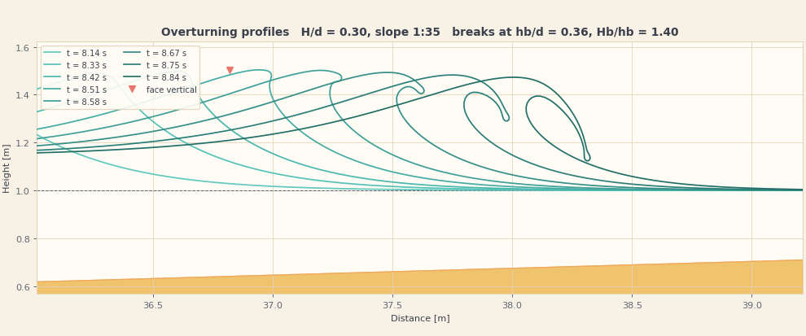

The overturn is measured as Feddersen et al. (2023, 2024) and Pick and Feddersen (2026) measure it at jet impact: the area $A_O$ enclosed by the overturn boundary, the area $A_J$ of the jet (the water above the tube, where the surface is multi-valued in $x$), both over the square of the highest elevation $H_I$, and the length $L$, width $W$ and angle $\theta_O$ of a Longuet-Higgins (1982) curve fitted to the boundary. Feddersen et al.'s (2024) DNS reproduces in 2D the soliton of their field-scale experiments in the Surf Ranch wave pool. The model runs the same case from the same starting wave, a Green-Naghdi solitary wave of $a_0/h_0 = 0.6$, and meets the criteria set before the comparison for the impact location, height, overturn area, jet area and angle. $W/L$ fails against the DNS but matches the field measurement at zero wind, and Pick and Feddersen's potential flow gives 0.41 for this case, so on this measure the DNS stands apart from both. Across plane slopes the overturn follows Pick and Feddersen's potential flow fits in every measure but the jet area, which is up to 19% above their fit while 12% below the DNS; it grows fast in the last instants before impact, which each study fixes in its own way.

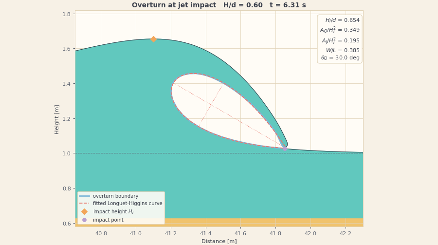

Not validated: the solitary wave over the reef in the GIF. Blenkinsopp and Chaplin's (2008) reef flume ran periodic waves, which `ReefOverturn` runs (below), and Mead and Black's (2001) relation between seabed gradient and tube shape comes from photographs of surf breaks rather than controlled conditions.

#### Splash-up (potential flow handed to SPH)

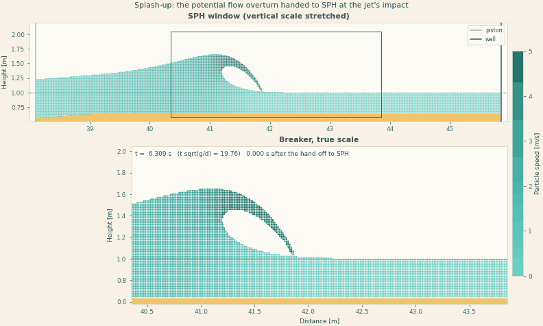

```python
from pysurf.OverturningWave import OverturningWave
from pysurf.SplashUp import SplashUp

wave = OverturningWave(depth = 1.0, waveHeight = 0.3, beachSlope = 1 / 35)
wave.run()                                   # to the instant the jet lands
splash = SplashUp(wave, particlesPerDepth = 64)
splash.run()
splash.summary()                             # the hand-off, the window, the energies
splash.writeAnimation('splashUp.gif', dpi = 72)
```

Potential flow ends where the jet lands: after that the surface encloses the tube and the impact makes vorticity. `SplashUp` hands the flow at that instant to the SPH solver, in a window from three depths behind the crest to six ahead of the impact. Particles fill the water on a lattice, and the tube under the jet starts empty. Each particle takes the potential flow's velocity, evaluated inside the water from the boundary integral representation, and its pressure, from the unsteady Bernoulli equation with $\partial\phi/\partial t$ from a second boundary solution, set as its density through the equation of state, so the water starts in the balance it had instead of settling. Behind the window a piston moves with the potential flow's depth-averaged velocity, the wave behind it treated as translating at its crest speed, so cutting the tank sends no reflection toward the jet. Ahead, the water is still at rest; the run ends before the broken water reaches the wall there.

The GIF continues the Surf Ranch overturn validated above ($a_0/h_0 = 0.6$ on a 0.0693 slope) at 64 particles per depth. The jet lands, and a splash-up shoots almost vertically from where it lands, rising to $1.33H_0$ ($0.80d$) at $t\sqrt{g/d} = 1.4$ after the impact, 23% above the jet's own crest. It curls into a second plunging jet over a second cavity while the first tube collapses behind it. The broken water's leading edge advances at 0.83 to 0.89 of the crest speed, and the fastest splash leaves at 2.0 times the crest speed. Lim et al. (2015) saw both in deep-water plunging breakers, a first splash-up higher than the overturning jet and starting at up to 2.14 times the phase speed; that is consistency, not validation.

| Check | Reference | Result | Verdict |
| --- | --- | --- | --- |
| Velocity and pressure inside the water | Exact harmonic fields | $2 \times 10^{-4} k$ and $1.5 \times 10^{-4} \rho u^2$ at 80 nodes, second order | Pass |
| Still water handed off | Hydrostatic | At rest, pressure exact | Pass |
| SPH over the last 0.1 s before impact, 32 to 64 particles per depth | The validated potential flow (`OverturningWave`) | Surface gap at most 0.66 spacings; no water more than 0.05 spacings outside it | Pass (1 spacing) |
| Leading edge of the broken water, 64 and 96 particles per depth | Resolution | 4.18 and 3.91 m/s, 0.89 and 0.83 of the crest speed | Converged to 7% |
| Splash-up height, 64 and 96 particles per depth | Resolution | $1.324H_0$ and $1.331H_0$, at $t\sqrt{g/d} = 1.50$ and 1.35 | Converged to 0.5% in height, 10% in time |
| Share of energy lost in active breaking, $H_0/h_0 = 0.3$ on 3°, 48 particles per depth | Mostert and Deike (2020), DNS | 0.282 against 0.31 | Pass (30%), -9% |
| Dissipation rate $(\epsilon/\epsilon_0)(d_b/d_0)$, the same case | Mostert and Deike (2020), inertial model fit | 0.00206 against 0.00217 | Pass (30%), -5% |
| Share lost and dissipation rate, the same case under rounding-level changes | Three backends, starts jittered by $10^{-9}$ spacing | 0.280 to 0.290; 0.00206 to 0.00216 | Spread of 1.3% and 2.1% (one standard deviation) |
| Share lost and dissipation rate, 48 and 64 particles per depth | Resolution | 0.282 and 0.279; 0.00206 and 0.00200 | Within twice the rounding spread |

The flow after the impact is checked against the energy Mostert and Deike (2020) measured breaking solitary waves lose in two-phase DNS. They take the active breaking time from the face turning vertical to the kinetic energy falling to the potential; their plunging case, $H_0/h_0 = 0.3$ on a 3° beach, loses 0.31 of its energy over it, and across slopes of 2° to 5° their dissipation rate collapses onto $(\epsilon/\epsilon_0)(d_b/d_0) = 0.0281(h_b/d_0)^{3.152}$. `SplashUp` runs the same case with the window's offshore wall standing still eight depths behind the crest, so the window's energy changes only by dissipation, and the beach running on eight depths past the shoreline. The SPH water loses 0.282 of its energy, 9% under theirs, at a rate 5% under the fit, within the 30% set before the comparison. The breaking flow amplifies rounding: the same run on the numpy, compiled and GPU backends, and from starts jittered by $10^{-9}$ of a spacing, loses 0.280 to 0.290 at rates of 0.00206 to 0.00216, and at 64 particles per depth both move by less than twice that spread. The SPH model's dissipation is its artificial viscosity, not resolved turbulence, so the agreement holds for this breaker rather than making the model a model of turbulence. Not validated: the shape of the splash-up itself, for which no profiles of a solitary wave's splash-up were found. The water is single-phase: the air in the tube neither cushions its collapse nor escapes, as it does in a real breaker, and the spray, a few percent of the particles, depends on the resolution rather than on the sea.

#### Peeling breaker on an oblique reef (3D: potential flow slices handed to SPH plane by plane)

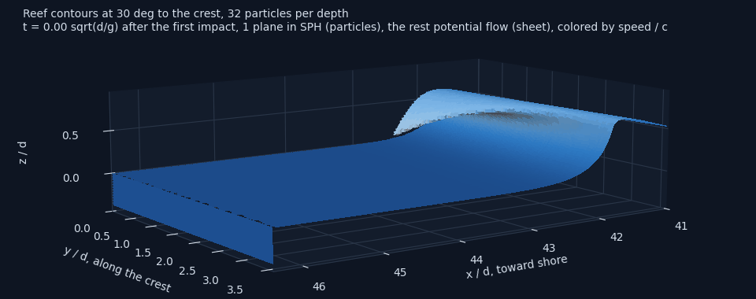

```python
from pysurf.bathymetry import Bathymetry
from pysurf.OverturningWave import OverturningWave
from pysurf.PeelingWave import PeelingWave

reef = Bathymetry.reefBreak(depth = 1.0, toeX = 30.0, faceSlope = 0.0693, reefDepth = 0.371, reefLength = 20.9)
wave = OverturningWave(depth = 1.0, waveHeight = 0.6, bathymetry = reef, startX = 15.0, startingWave = 'exact')
wave.run()                                   # the reef's profile, in 2D, to the jet's impact
peel = PeelingWave(wave, obliqueAngle = 30.0, particlesPerDepth = 32, backend = 'compiled')
peel.run()
ages, energy = peel.planeHistory()           # each plane's energy against the time since its own impact
```

The reef's depth contours run at an angle $\alpha$ to the incident crest: $z_b(x, y) = f(x - y\tan\alpha)$, with $f$ the 2D profile. A straight-crested wave that travels unchanged over the flat bed (the exact solitary wave does; the SGN wave, still adjusting, does not) makes the whole problem invariant under a shift along the contours combined with a delay of $y\tan\alpha/c$. Every cross-section is then the section at $y = 0$, shifted and delayed. Strip theory takes that section to be the 2D run. The stacked flow misses $\partial^2\phi/\partial y^2 = \tan^2\alpha\,(\partial_x + \partial_t/c)^2\phi$, which vanishes for anything travelling unchanged at $c$, so the incident wave is exact and the error lives in the breaking region at order $\tan^2\alpha$. Its spanwise velocity is $v = -\tan\alpha\,(u + \phi_t/c)$.

The SPH lattice is a set of planes one spacing apart, each the one before it delayed by $\delta = s\tan\alpha/c$, so the jet lands in successive planes $\delta$ apart and the break peels along the crest at $c/\tan\alpha$. Each plane joins the SPH water at its own impact, in the state the 2D `SplashUp` hand-off gives it, so every overturn is the boundary element model's. Ahead of the newest SPH plane, three buffer planes move with the potential flow at their own phase and carry its velocity, $v$ included, and its pressure. They all carry the same water, shifted, so the run follows one template plane through the last three lags before the impact once, and every buffer plane takes its state from it. Each plane's offshore wall is a piston driven as `SplashUp` drives its own, delayed by the plane's lag. The run takes the compiled SPH backend (`sphCompiled`, numba across threads): 111 planes and 470,000 fluid particles at 32 particles per depth ran 1.6 $\sqrt{d/g}$ in 68 minutes on four threads, after 4 minutes restarting the overturn and following the template.

The GIF is the Surf Ranch reef of the overturn above, with its contours at 30° to the crest, from the exact solitary wave of $H/d = 0.6$, at 32 particles per depth, over $1.6\sqrt{d/g}$ from the first plane's impact. Particles are the SPH water; the planes still in the potential flow, each at its own phase, are drawn as one shaded sheet. Both are colored by speed, from deep blue at rest to white at twice the wave speed, the sheet by the stacked flow's speed with strip theory's spanwise velocity included. The view is at true scale, low and from shoreward of the reef ahead of the peel, looking back along the crest into the tube as the wave runs and peels toward the camera. The water is cut at the end of the first plane's SPH window, down to the reef flat. The jet lands, splashes up and plunges a second time in every plane, peeling toward $+y$ at $2.16\sqrt{gd}$.

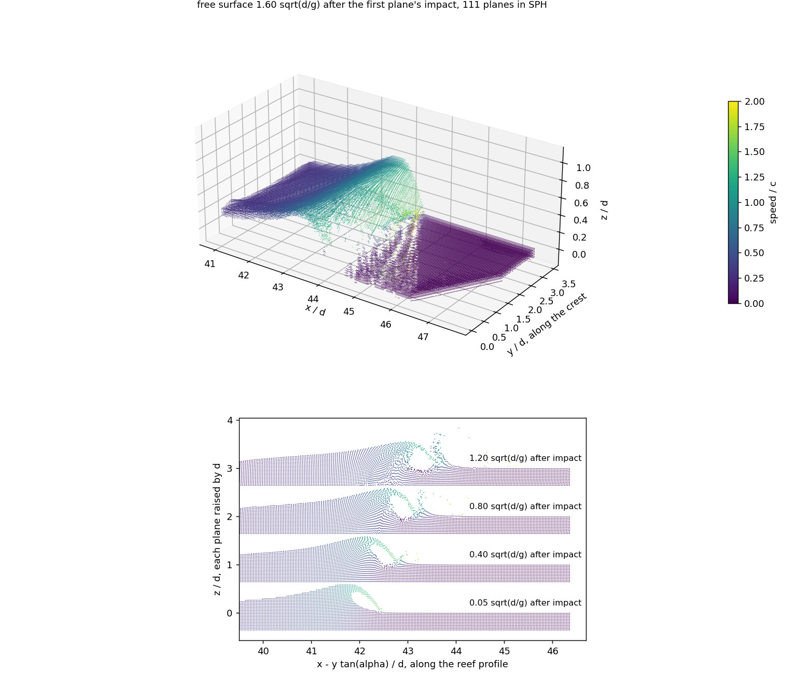

| Check | Reference | Result | Verdict |
| --- | --- | --- | --- |
| The incident wave's speed over the flat bed | The exact solitary wave, $1.24999\sqrt{gd}$ | 3.9125 m/s against 3.9144 m/s in 1 m of water | -0.05%; Pass (0.2%) |
| A steady peel: the newest half of the planes, energy at 0.25, 0.5, 0.8 and 1.2 $\sqrt{d/g}$ after their impact, with and without spanwise velocity | Each other | Spread at most 0.6%, 0.8%, 1.2%, 1.7% of their energy at impact | Pass (5%) |
| Without spanwise velocity, those planes' median against the 2D splash-up, the same ages | `SplashUp`, the same window and piston | Within 0.1% at every age | Pass (5%) |
| With strip theory's spanwise velocity, the same | `SplashUp` | Within 0.1% to 0.8 $\sqrt{d/g}$, 1.2% above at 1.2 | Pass (5%) |
| Resolution, 16 and 32 particles per depth | | Plane energies within 0.7%; sideways drift 0.023 and 0.027 $d$ at 0.8 $\sqrt{d/g}$ | |

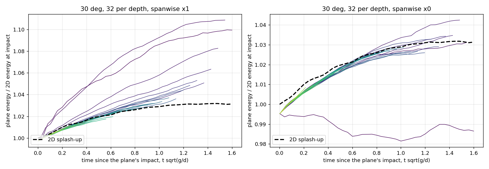

Away from the wall at $y = 0$ the peel is steady: every plane's energy follows the same history, and that history is the 2D splash-up's to a percent. With strip theory's spanwise velocity the water drifts toward the broken side, $0.027d$ by $0.8\sqrt{d/g}$ after impact, and the top of the water moves by under $0.01d$ against the run without it, so at 30° the peeling breaker's cross-sections behave as the 2D splash-up delayed plane to plane. The free-slip wall at $y = 0$ stands where older broken water would continue: it feeds energy into the oldest planes with the spanwise velocity (up to +9.5%), and without it the oldest plane loses at most 1.1%; with the spanwise velocity its influence spreads several planes toward the peel over the run.

Not validated: no measurement or 3D simulation of a solitary wave peeling along an oblique reef was found. The checks above test the construction, not the flow. Strip theory's spanwise velocity is the least certain part of the state handed to SPH: on Guyenne and Grilli's ridge it is 70% high. At 30° it changes the plane energies by about 1% and moves the water sideways by under three hundredths of a depth, which brackets how much it matters here; the bracket would widen with the angle, as $\tan^2\alpha$. The stacked state's divergence, $\partial v/\partial y$, is 1.1% rms of the in-plane divergence and up to 34% locally in the jet (`stripResidual`); the SPH water absorbs it as a density disturbance when each plane joins it. The water is single-phase.

##### Triangular reef: peeling both ways

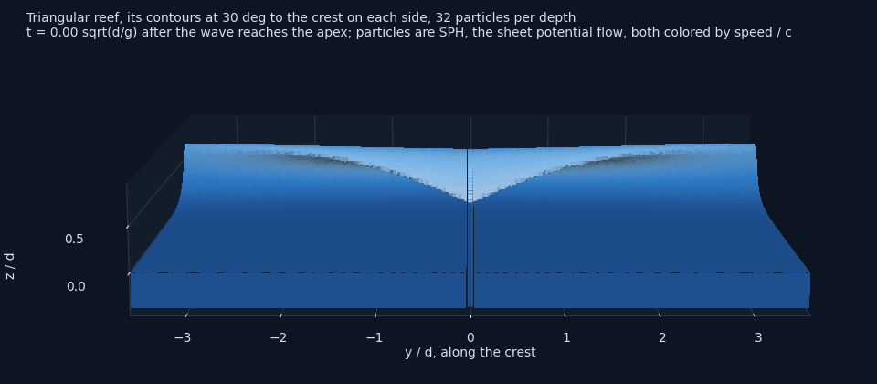

```python
frame = peel.frames[-1]
both = np.vstack([frame.positions, frame.positions * [1.0, -1.0, 1.0]])   # the half y > 0 and its mirror image
```

A triangular reef, $z_b = f(x - |y|\tan\alpha)$, is two oblique reefs joined at an apex on $y = 0$ that points offshore. The wave reaches the apex first and peels both ways at $c/\tan\alpha$. For flow that stays symmetric about $y = 0$, the run above is its half $y > 0$: the free-slip wall at $y = 0$ is the symmetry plane, and the energy it feeds the oldest planes is the two halves' water meeting behind the apex. The GIF draws that run with its mirror image, head on from the shore at true scale, in the same colors and with the same cut as the oblique reef's.

Not validated, as above, with two further limits at the apex. The symmetry plane rules out any breaking that is not symmetric. The reef's contours turn at the apex, so strip theory is least accurate there: it hands the planes beside the wall a spanwise velocity of $\tan\alpha\,(u + \phi_t/c)$ toward the apex, where the three-dimensional flow's would fall to zero. With that velocity the oldest planes gain up to 9.5% of their energy; without it the oldest plane loses at most 1.1%.

#### Reef break (swell, Serre-Green-Naghdi)

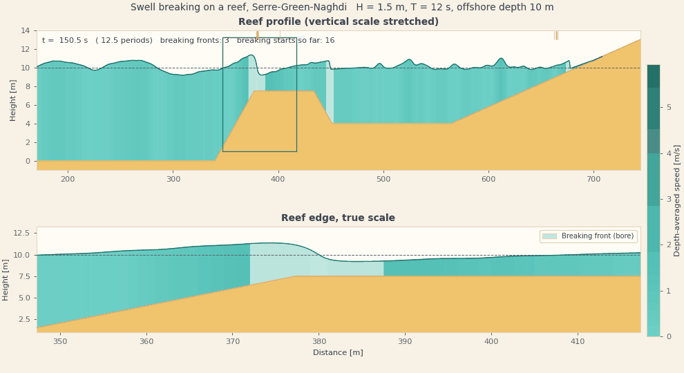

```python
from pysurf.ReefBreak import ReefBreak

reef = ReefBreak(depth = 10.0, waveHeight = 1.5, period = 12.0)
reef.run()
reef.summary()                               # breaking zones, where breaking stops
reef.writeAnimation('reefBreak.gif', lastPeriods = 3)
```

`ReefBreak` drives the SGN solver with regular swell over a reef from `Bathymetry.reefBreak`: 10 m offshore, a 1:5 reef face up to a reef flat 2.5 m deep, a 6 m lagoon and a 1:20 beach. A mass source offshore (Wei, Kirby and Sinha 1999) sends 1.5 m, 12 s waves at the reef; the half that runs seaward is absorbed in a layer at the offshore end. The dispersion parameter is Bonneton et al.'s 1.159, which holds the phase speed within 1% of Airy's out to $kd = 3$. Breaking is decided front by front: a front starts when it is steeper than 30 degrees and strong enough to be a breaking bore, and stops when its bore Froude number has stayed below 1.3 for $5\sqrt{h/g}$, the transition time of Kennedy et al. (2000).

Each wave shoals from 1.5 m to 2.1 m on the face and starts breaking at the reef edge, 379 m out, over 3.2 m of still water. The bore crosses the reef flat, weakens in the lagoon, and stops breaking at 463 m with a bore Froude number of 1.11. The wave reforms, crosses the lagoon, and breaks again as a shore break at 665 m in 1.2 m of water. The cycle repeats every period.

| Check | Reference | Result | Verdict |
| --- | --- | --- | --- |
| Wave height from the source, $kd$ = 0.5 to 1.5, 120 cells per wavelength | Linear SGN theory | within 0.4% | Pass |
| Reflection from the absorbing layer | None | 0.1% | Pass |
| Standing wave period with $\alpha = 1.159$, $kd = 2$ | $\alpha$-SGN dispersion; Airy | within 0.2%; 0.6% from Airy | Pass |

Not validated: breaking over the reef itself. Run in Blenkinsopp and Chaplin's (2008) flume by `ReefOverturn` (below), the same solver reflects 1.5 to 2.1 times what the flume reflected and passes up to 44% more over the reef: its breaking dissipates too little on a steep reef face. Fringing-reef experiments such as Yao et al. (2012) would test it at a scale nearer the sea's.

#### Reef overturn (SGN train handed to potential flow)

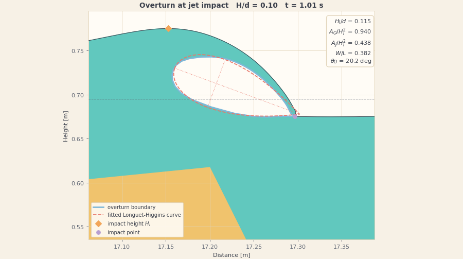

```python
from pysurf.ReefOverturn import ReefOverturn

reef = ReefOverturn(crestDepth = 0.077, deepWaterHeight = 0.0755, frequency = 0.6)
reef.run()                                   # SGN train, hand-off, overturn to the jet's impact
reef.summary()                               # reflection, transmission, breaker indices, cavity
reef.wave.drawOverturn()
```

`ReefOverturn` builds Blenkinsopp and Chaplin's (2008) flume: a reef 0.618 m high with a 1:10 face in 0.68 to 0.72 m of water, its toe 3.8 m from the wave source. The SGN model runs a regular train over it until the train is periodic. A third of a period before SGN starts breaking a wave at the crest, the state goes to the boundary element model (`sgnHandoff`): the surface is the SGN surface, and the potential solves a Neumann problem whose flux is the rate the surface rises, $\eta_t = -\partial q/\partial x$, exact for any depth over wavelength. The tank's walls stand where the discharge crosses zero and the surface rises slowest. Behind the reef lie the bores of waves already broken, whose fronts of 30 to 40° potential flow cannot start from; they are smoothed to under 11°, keeping their mass, and the crest and the jet are sought no further than a quarter wavelength behind the reef. The reef drops behind its crest at 2:1 where the flume's drops vertically, since the SGN model's dispersive solve needs a bed of finite slope. Each water level runs in about three minutes.

The measures are the flume's. At the break point, where part of the face first turns vertical, $H_b$ runs from the trough ahead of the face to the crest and $h_b$ is the still water depth under the vertical face; at the plunge point the cavity is the Longuet-Higgins (1982) curve fitted to its boundary, $l_c$ long and $w_c$ wide, with area $A_c = (2\sqrt{3}/5) l_c w_c$. Ahead of the reef the train's first harmonic is split into incident and reflected waves; behind it the transmitted height is the mean crest-to-trough height a wavelength on. The reference values are Blenkinsopp and Chaplin's points for 0.6 Hz waves of $H_0 = 75.5$ mm in deep water ($H_0/L_0 = 0.0174$) at nine water levels, digitized from their figures by marker color. The criteria follow their stated errors: 20% on the cavity area, 10% on each length and so 15% on their ratio, 20% on the breaker indices and on $K_r$ and $K_t$, and 5% on the incident height.

| Quantity, $h_c$ = 62 to 102 mm | Reference | Reference value | Model value | Error | Verdict |
| --- | --- | --- | --- | --- | --- |
| Incident height $H_i$ | Blenkinsopp and Chaplin (2008), fig. 10 | 68.4 to 69.6 mm | 66.6 to 69.0 mm | -3.5% to +1% | Pass (5%) |
| Reflection from the absorbing layers, flat bed | None | | 1.4% | | Pass |
| Reflection coefficient $K_r$ | Fig. 11 | 0.12 to 0.20 | 0.26 to 0.33 | +46% to +111% | Fail (20%) |
| Transmission coefficient $K_t$ | Fig. 10 | 0.54 to 0.84 | 0.77 to 0.94 | +11% to +44% | Fail (20%) |
| Breaker depth index $H_b/h_b$ | Section 3.1.1 | 0.85 | 0.99 to 1.26 | +16% to +48% | Fail (20%) |
| Breaker height index $H_b/H_0$ | Eq. 3 | 1.12 | 1.23 to 1.76 | +9% to +56% | Fail (20%) |
| Cavity ratio $l_c/w_c$, $h_c/H_0 \le 0.95$ | Fig. 6 | 2.07 to 2.29 | 2.26 to 2.34 | +2% to +9% | Pass (15%) |
| Cavity ratio $l_c/w_c$, $h_c/H_0 \ge 1.02$ | Fig. 6 | 1.55 to 2.00 | 2.57 to 5.88 | +28% to +269% | Fail (15%) |
| Cavity area $A_c/H_b^2$ | Fig. 7 | 0.04 to 0.22 | 0.02 to 0.45 | -80% to +164% | Fail (20%) |

| $h_c$ [mm] | $h_c/H_0$ | $K_r$, model / flume | $K_t$, model / flume | $H_b/h_b$ | $H_b/H_0$ | $l_c/w_c$, model / flume | $A_c/H_b^2$, model / flume |
| --- | --- | --- | --- | --- | --- | --- | --- |
| 62 | 0.82 | 0.26 / 0.12 | 0.77 / 0.54 | 0.99 | 1.23 | 2.29 / 2.10 | 0.42 / 0.22 |
| 67 | 0.89 | 0.27 / 0.14 | 0.78 / 0.57 | 1.07 | 1.40 | 2.34 / 2.29 | 0.35 / 0.21 |
| 72 | 0.95 | 0.31 / 0.15 | 0.81 / 0.60 | 1.25 | 1.63 | 2.26 / 2.07 | 0.28 / 0.18 |
| 77 | 1.02 | 0.33 / 0.16 | 0.81 / 0.65 | 1.20 | 1.54 | 2.62 / 1.90 | 0.45 / 0.20 |
| 82 | 1.09 | 0.26 / 0.18 | 0.82 / 0.72 | 1.03 | 1.37 | 4.02 / 1.82 | 0.42 / 0.16 |
| 87 | 1.15 | 0.27 / 0.19 | 0.84 / 0.75 | 1.10 | 1.50 | 5.88 / 1.60 | 0.15 / 0.13 |
| 92 | 1.22 | 0.29 / 0.19 | 0.88 / 0.80 | 1.16 | 1.63 | 4.00 / 1.56 | 0.024 / 0.12 |
| 97 | 1.28 | 0.30 / 0.20 | 0.94 / 0.82 | 1.26 | 1.76 | 3.24 / 1.73 | 0.019 / 0.06 |
| 102 | 1.35 | 0.33 / 0.19 | 0.94 / 0.84 | 1.21 | 1.69 | 2.57 / 2.00 | 0.023 / 0.04 |

The incident wave matches the flume; nothing after it does. The SGN train reflects 1.5 to 2.1 times what the flume reflected and passes up to 44% more over the reef. By the linear balance $1 - K_r^2 - K_t^2$ its breaking takes 0.34 of the incident energy at $h_c$ = 62 mm, where the flume's took 0.70, and 0.14 at 92 mm against 0.33. The waves it hands over break 16 to 48% higher against the depth than the flume's. Those breaker indices sit among the plane-slope relations Blenkinsopp and Chaplin plot (about 1.1 to 1.3 for $H_b/h_b$ at this steepness, all but McCowan's 0.78) rather than on their reef data, which they explain by the return flow from the wave before; here that return flow comes from a train that dissipates too little. The cavity ratio matches the flume within 9% up to $h_c/H_0 = 0.95$. From $h_c$ = 72 mm the jet lands past the crest, over the 2:1 back slope that stands in for the flume's vertical drop, and from $h_c/H_0 = 1.09$ the cavity grows long and thin. Its area falls with submergence as the flume's does, but it is 1.5 to 2.6 times the flume's up to $h_c/H_0 = 1.09$ and a fifth to a half of it from 1.22. The flume's 0.44 m width also puts side-wall friction on the jet, which Blenkinsopp and Chaplin report; neither that nor their stated errors cover these gaps. The overturn itself is validated (above); what fails here is the wave it is handed. Closing the gap needs SGN breaking that dissipates as a plunging breaker does on a steep reef, checked first against $K_r$ and $K_t$.

#### Particle model (SPH)

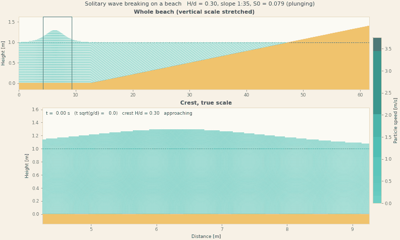

```python
from pysurf.BreakingWave import BreakingWave

wave = BreakingWave(depth = 1.0, waveHeight = 0.3, beachSlope = 1 / 35, particlesPerDepth = 64,
                    scheme = 'deltaSph', backend = 'gpu')
wave.run()
wave.summary()                               # breaking point, breaker type, the jet's landing
wave.writeAnimation('breakingWave.gif', dpi = 72)
```

`BreakingWave` is a facade like `Surfboard`: it lays out the bed (`bathymetry`), places the exact solitary wave already moving (`waveMakers`), builds the bed and a seaward wall from boundary particles (`sphBoundaries`), steps the solver (`sphSolver`, on the GPU through `sphGpu`), and tracks the crest, the breaking point and the jet's landing (`waveBreaking`). The 'deltaSph' scheme is the one validated below:

- the Wendland C2 kernel, with a smoothing length of three particle spacings;
- density diffusion (δ-SPH, Molteni and Colagrossi 2009) acting on the density less its hydrostatic part, so still water stays at rest;
- the kernel gradient correction of Bonet and Lok (1999) in the continuity equation;
- wall pressure carried from the water to the boundary particles (Adami et al. 2012);
- Monaghan's artificial viscosity at α = 0.01, limited so it damps the particles' noise and leaves the smooth strain under the crest alone;
- fluid density held at 0.9 ρ₀ or above.

The water starts in columns half a spacing clear of the bed (`bedFitted`). On a square lattice the lowest particles over a slope sit up to a spacing and a half above the bed; they fall into its steps, and still water laid that way never settles. The breaking point is where the front face turns vertical: the start of its last vertical run before the jet lands, read on the smoothed surface. Particles are colored by speed. The GIF is Grilli's case at 64 particles per depth, 128,947 particles, run to 17.3 s in 21 minutes on an RTX 2070 Super. It breaks at $H_b/d = 0.496$ and $h_b/d = 0.316$, the values in the table below. Its frames lie 0.1 s of flow apart from 8 to 12.5 s, where the wave breaks and the jet lands, and 0.2 s apart elsewhere.

| Quantity | Reference | Reference value | Model value | Error | Verdict |
| --- | --- | --- | --- | --- | --- |
| Breaking height $H_b/d$, $H/d = 0.3$, slope 1:35, 64 particles per depth | Grilli et al. (1997) | 0.476 | 0.496 | +4.3% | Pass (10%) |
| Breaking depth $h_b/d$, the same | Grilli et al. (1997) | 0.345 | 0.316 | -8.4% | Pass (15%) |
| $H_b/d$ and $h_b/d$ at 128 particles per depth | Grilli et al. (1997) | 0.476, 0.345 | 0.484, 0.335 | +1.6%, -2.8% | Pass |
| $H_b/d$ and $h_b/d$ at 32 particles per depth | Grilli et al. (1997) | 0.476, 0.345 | 0.486, 0.278 | +2.1%, -19.5% | Fail ($h_b$) |
| Overturn at the jet's landing, Surf Ranch soliton ($H/d = 0.6$), 128 particles per depth | Feddersen et al. (2024), DNS | | Lands 0.04 $d$ short; $H_I$ -0.9%, $A_O/H_I^2$ -3%, $A_J/H_I^2$ -11.5%, $\theta_O$ -3.6° | | Pass, all five |
| The same at 64 particles per depth | Feddersen et al. (2024), DNS | | Four pass; $\theta_O$ -5.2° | | Fail (5°) |
| Surface 0.1 $\sqrt{d/g}$ before the jet lands, 32, 64 and 128 particles per depth | The validated potential flow (`OverturningWave`) | | Up to 11, 15 and 14 spacings apart | | Fail (2 spacings) |
| Share of energy lost in active breaking, $H_0/h_0 = 0.3$ on 3°, 32 and 64 particles per depth | Mostert and Deike (2020), DNS | 0.31 | 0.20, 0.17 | -35%, -47% | Fail (30%) |
| Bore height over a reef flat at WG12, 10.6 m past the edge, $H_0/h_0 = 0.4$, 128 particles per depth, three runs | Quiroga and Cheung (2013), flume | 0.608 | 0.757 to 0.786 | +24.5% to +29.3% | Fail (10%) |
| Exact solitary wave over 29 depths of flat bed, 32 and 64 particles per depth | Closed form | | Height under 0.8% low | | Pass (2%) |
| Still water after 20 $\sqrt{d/g}$, 60 particles per depth | At rest | rms speed $10^{-3}\sqrt{gd}$ | $7.1 \times 10^{-4}\sqrt{gd}$ | | Pass |

The breaking point converges with resolution: the breaking depth converges at first order, and Richardson extrapolation of the three resolutions gives $h_b/d = 0.355$, 3.0% from Grilli's. At 32 particles per depth the wave breaks too far up the slope. The overturn passes all five of the DNS criteria at 128 particles per depth, but its area does not converge monotonically (0.495, 0.308 and 0.341 $H_I^2$ at 32, 64 and 128, against 0.352), so the pass holds at 128 and is not a converged result.

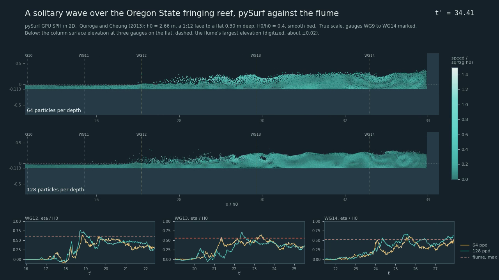

After the wave breaks, the model dissipates too little, and the shortfall grows as the spacing shrinks. The model has no turbulence. Its artificial viscosity and density diffusion stand in for the loss, and both scale with the spacing. On Mostert and Deike's beach it loses 35% too little of its energy in active breaking at 32 particles per depth and 47% too little at 64. The figure above is the fringing reef Quiroga and Cheung (2013) ran in Oregon State University's Large Wave Flume: 2.66 m deep, a 1:12 face, and a flat 0.30 m deep closed by a wall. At 128 particles per depth the bore 10.6 m past the reef edge stands 24.5 to 29.3% above the flume's. That holds in three runs whose changes leave the physics alone (the time step 10% shorter, the crest started half a spacing further on), clear of their spread, and every 128 run stands above every 64 run. Two of the model's simplifications raise the bore as well, the free-slip bed and the missing air, but a Manning estimate puts the bed's part near 10%. At the next two gauges the three runs straddle the 10% band, so those gauges cannot separate the model from the flume. Bore heights, runup and the splash are therefore unvalidated, and probably high.

DualSPHysics's settings do not close the gap. Carried into pySurf (c0 = 20 $\sqrt{gd}$, negative pressure allowed, no viscosity limiter, the viscosity applied against the bed at rest, h = 1.5 spacings), they reproduce DualSPHysics's loose particles and slower front over the reef flat, though not its lower bore. On Mostert and Deike's beach they lose 0.545 and 0.607 of the energy in active breaking at 64 and 32 particles per depth, 76% and 96% too much, and drain about 1% of the wave's energy per depth it travels before it breaks. Settings chosen between the two sets to land on Mostert and Deike's share would be calibration, not validation.

The animations in `examples/breakingWave/`:

- [reefFlat.mp4](examples/breakingWave/reefFlat.mp4): the figure above in motion, the 64 and 128 runs over the flat with the gauge records.
- [reefFlatScatter128.mp4](examples/breakingWave/reefFlatScatter128.mp4): the three 128 runs stacked.
- [reefFlatDualSphysics.mp4](examples/breakingWave/reefFlatDualSphysics.mp4): DualSPHysics's run of the same reef beside pySurf's, a cross-check.
- [surfRanchReefResolution.mp4](examples/breakingWave/surfRanchReefResolution.mp4): the Surf Ranch reef run past the jet's landing at 16, 32 and 64 particles per depth. 32 and 64 agree after breaking. At all three the bore loses energy within 30% of the rate the hydraulic jump relation gives for its height, a check against theory, not validation.

The default scheme, 'shepard', is the original: a cubic spline kernel at 1.3 spacings and a Shepard density filter. It holds the solitary wave's speed (within 0.5% at 12 particles per depth) and the first sloshing period (2.2%). It fails Grilli's breaking point at 16 particles per depth ($H_b/d$ -32%, $h_b/d$ -72%): numerical damping drains the wave faster than shoaling builds it.

#### Breaking over a 3D bed (GPU SPH)

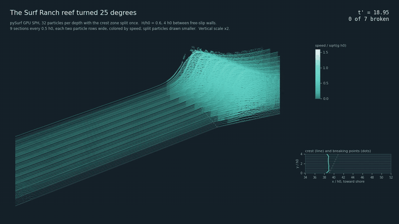

```python
import numpy as np

from pysurf.bathymetry import HeightField
from pysurf.BreakingWave3D import BreakingWave3D, offshoreReach

def reefBed(x: np.ndarray, y: np.ndarray) -> np.ndarray:
    '''The Surf Ranch reef with straight contours: a 0.0693 face from x = 0 to a shelf 0.371 deep.'''
    return np.clip(0.0693 * x, 0.0, 1.0 - 0.371) + 0.0 * y

reef = HeightField.fromFunction(reefBed, (-30.0, 40.0, -30.0, 30.0), 1.0 / 32.0, stillWaterLevel = 1.0)
region = (-25.0, 21.0, -4.0, 4.0)                                # the tank, in the wave's frame
turned = reef.rotated(30.0, region, pivot = (0.0, 0.0))         # the wave meets the contours at 30 degrees
wallX, crestX = offshoreReach(turned, 0.6, depth = 1.0)
region = (wallX, 21.0, -4.0, 4.0)
zoneFrom = turned.cropped(region).shoalingStart(depth = 1.0, share = 0.45)
wave = BreakingWave3D(reef, 0.6, crestX, depth = 1.0, particlesPerDepth = 32, sections = (-2.0, 0.0, 2.0),
                      direction = 30.0, region = region, pivot = (0.0, 0.0),
                      refinement = {'levels': 1, 'behind': 1.0, 'ahead': 1.5, 'above': -0.4,
                                    'fromX': zoneFrom, 'mergeBehind': 1.5})
wave.run()
wave.summary()                               # each section's breaking point and the jet's landing
```

`BreakingWave3D` runs `BreakingWave`'s δ-SPH scheme in a rectangular tank over a height field (`bathymetry.HeightField`). The bed comes from a numpy grid, a function or an x, y, z text file, smoothed to the particle scale. For a wave arriving at an angle, the bed is turned so the wave travels along +x (`direction`), and the free-slip side walls then run along the wave. `offshoreReach` starts the exact solitary wave a half length offshore of where the bed starts to shoal, so it crosses as little water as it can before it breaks. Vertical sections across the tank, each two particle rows wide, carry the 2D breaking tracker. An 8 GB card holds a uniform lattice of 32 particles per depth on these tanks. Finer water near the crest comes from a zone that follows it (`refinement`, `sphRefinement`): the zone splits the water once from 1 depth behind the crest to 1.5 ahead, from 0.4 depth under still water up, and merges the daughters again 1.5 depths behind it. A run of a day or more can stop and continue: `saveCheckpoint` writes the whole state between calls to `run`, about 1 GB at 32 particles per depth, and `restore` takes it up in a new process. On the GPU the restored run ends bit for bit where the run that never stopped ends.

The GIF is the Surf Ranch reef turned 25 degrees between walls 4 depths apart, at 32 particles per depth with the crest zone: 6.6 million particles by the end, 32 GPU hours. The seven inner sections break one after another along the reef.

| Quantity | Reference | Result | Verdict |
| --- | --- | --- | --- |
| Breaking point on the sloping ridge, k = 0.10 to 0.50, 32 particles per depth | Guyenne and Grilli (2006), 3D potential flow | Four of five pass: time +1.2% to +4.7%, crest position +0.07 to +0.41 $d$, crest height -4.5% to -0.5%. At k = 0.25 the crest stands 0.53 $d$ past theirs | Fail at k = 0.25 (0.5 $d$) |
| Breaking point at k = 0.25, with the crest zone | Guyenne and Grilli (2006) | Time +2.9%, crest position +0.39 $d$, crest height -0.2% | Pass (5%, 0.5 $d$, 5%) |
| Largest horizontal speed under the crest, and spanwise over streamwise, k = 0.25 | Guyenne and Grilli (2006) | -0.3% and +0.1%; with the zone -0.6% and +1.0% | Pass (10%, 30%) |
| Crest crossing a uniform oblique reef at 30°, 16 particles per depth, tank 16 $d$ across | Closed form, $c_0 / \tan 30°$ | Within 1.7% at every distance from 2 $d$ before the toe to 11 past it | Pass |
| The Surf Ranch reef extruded across a tank 1 $d$ wide, 32 particles per depth | The 2D model | Breaking within 0.25% in time and 1.3% in height; with the zone, all eight overturn readings within half the gates' tolerances | Consistent |
| The Surf Ranch reef turned 25°, seven sections, 32 particles per depth | DualSPHysics, a cross-check | Breaks within 0.04 s of DualSPHysics and 8% to 11% higher; the jet lands 0.03 to 0.13 s later | Reported |

The model's claim is the breaking point, at 32 particles per depth with the crest zone. The bed, its rotation and the tank carry the wave there: the extruded reef matches 2D, the crest crosses the oblique reef at the closed form's speed, and on the turned reef the wave breaks with DualSPHysics's. Without the zone the 2D scheme's lag at 32 particles per depth carries into 3D: the ridge's centre line, run in 2D, breaks 0.37 $\sqrt{d/g}$ after Guyenne and Grilli's 2D result, against 0.10 at 64. Less that lag, the breaking point's shift from 2D to 3D matches theirs within 0.02 $\sqrt{d/g}$ at k = 0.25 and 0.34.

Not validated: the overturn's shape in 3D, and everything after breaking. In 2D the crest zone fails the Surf Ranch overturn from both a 32 and a 64 particles per depth base, and no measurement of a 3D overturn's lip exists. After breaking, the 2D model's shortfall in dissipation applies (above), so bores and splashes are probably too high. On the oblique reef the break crosses the span 9% to 11% slower than $c_0 / \tan 30°$ in the 16 $d$ tank and 15% to 21% slower in an 8 $d$ one. The free-slip walls mirror the bed into a chevron reef, and the breaking point creeps shoreward between them, a limit of a walled tank; the closed form covers the crest only. On the turned reef pySurf's jet lands after DualSPHysics's, where in 2D it landed 0.55 s before, and the runs do not say which code departs from 2D in that tank.

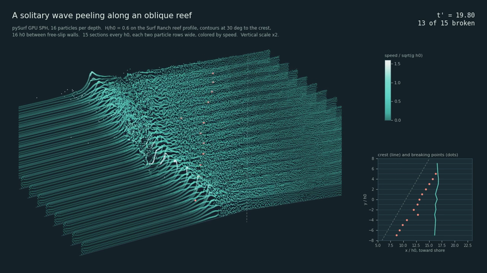

The animations in `examples/breakingWave3D/`:

- [shoalReef32.mp4](examples/breakingWave3D/shoalReef32.mp4): the GIF above at full resolution.
- [shoalReefParticles32.mp4](examples/breakingWave3D/shoalReefParticles32.mp4): the same reef and resolution run again to 24 $\sqrt{d/g}$, saving the whole fluid every 0.025 $\sqrt{d/g}$ from 19.5 on, and drawn from its particles: the camera sits low and shoreward of the reef, ahead of the peel, looking back along the crest into the tube. Each frame draws the particles nearest the camera, colored by speed over the wave's. The breaking point runs along the crest at about 3.5 $\sqrt{gd}$ with the lip landing behind it, and the bore then crosses the shelf. The run took 31.7 GPU hours; it stopped twice, once paused and once out of host memory, and took up its last checkpoint each time. Not validated: the overturn and the bore lie past the breaking point.
- [shoalReef16vs32.mp4](examples/breakingWave3D/shoalReef16vs32.mp4): the same reef at 16 and 32 particles per depth, stacked. At 16 the shelf is six particles deep, and the breaker curls without a clean jet.
- [obliqueReef16.mp4](examples/breakingWave3D/obliqueReef16.mp4): the oblique reef above, at 16 particles per depth.
- [pipelineLeft16.mp4](examples/breakingWave3D/pipelineLeft16.mp4): a measured bed, the left at Pipeline, Oahu. The bed is the USACE 2013 topobathy lidar with depths capped at 10 m, turned so a 3 m solitary wave from 295 degrees travels along +x, in a tank 160 m across with 15 sections. At 16 particles per depth with the crest zone the run took 10.5 GPU hours. The break starts toward the south-southwest end of the tank and peels along the crest toward the north-northeast at about twice the crest's speed.
- [pipelineStrips16.mp4](examples/breakingWave3D/pipelineStrips16.mp4): six of its sections, 20 m apart, side on at true scale and stacked so the peel runs down the frame. Each lip throws a sheet one or two split particles (0.3 m) thick that breaks into droplets before it lands, so no tube closes. Not validated: 16 particles per depth is below the model's claim, and the overturn lies past the breaking point.

### [WaterSim →](src/pysurf/WaterSim/README.md)

Ready-to-run SPH scenarios built from the water modules: a sloshing tank (2D and 3D) and a numerical wave tank with a piston wave maker sized by Biesel's transfer function. WaterSim imports nothing from the board model.

```bash
python -m pysurf.WaterSim   # Run default sloshing tank
```

### Water modules

| Module | Purpose |
| --- | --- |
| `waveTheory` | Linear dispersion, phase and group speed, kinematics and energy; first-order and exact SGN solitary waves; the exact potential flow solitary wave (Babenko's equation); SGN linear dispersion; Biesel piston transfer function; sloshing frequencies; McCowan, Miche, Iribarren and Grilli breaking criteria |
| `sgnSolver` | Serre-Green-Naghdi equations: shallow-water finite volumes with hydrostatic reconstruction, the dispersive tridiagonal solve, and the Tissier breaking switch |
| `sgnHandoff` | An SGN state handed to the boundary element model: wall placement, bore smoothing, the surface potential from a Neumann solve |
| `bemSolver` | Fully nonlinear potential flow by boundary elements: the Lagrangian free surface, regridding and smoothing, jet and overturn measures, and the flow inside the water (velocity, and pressure from $\phi_t$) |
| `sphHandoff` | The potential flow handed to SPH particles in a window: seeding, density from the pressure, boundary pressure, piston |
| `sliceStack` | A 3D potential flow from 2D boundary element slices across a bed that varies along the crest (strip theory), run in parallel; the spanwise velocity from the slices' potentials |
| `bathymetry` | The bed as a 2D polyline: elevation, depth, slope, normal, shoreline, equal-arc sampling, sand outline. In 3D a height field (`HeightField`) from a numpy grid, a function or an x, y, z text file: smoothed, cropped, turned into a wave's frame, and where it starts to shoal |
| `sphKernels` | Cubic spline and Wendland C2 kernels, pair and batch forms |
| `sphNeighbors` | Every particle pair inside the kernel support, from a k-d tree, optionally across a periodic axis |
| `sphParticles` | Particle state, energy diagnostics, lattice seeding and region fills, columns fitted to a bed, particles added mid-run |
| `sphBoundaries` | Container and bed boundaries of fixed particles, with enforcement; beds extruded across a walled or periodic 3D channel, or sheared across it with a piston per particle row; a height-field bed in a walled tank, enforced on the GPU |
| `sphSolver` | Tait equation of state, continuity density, Shepard filter or δ-SPH density diffusion, the kernel gradient correction, wall pressure from the water, artificial viscosity (plain or limited), XSPH, CFL step, and the solver that composes them; a periodic spanwise axis |
| `sphCompiled` | The solver's per-step sums compiled with numba and run across threads over a cell-linked neighbor list, for 3D runs (`backend = 'compiled'`) |
| `sphGpu` | The same sums on a GPU through NVIDIA Warp, and the whole time step on the device for `advance` (`backend = 'gpu'`): float32 pair arithmetic, float64 state |
| `sphFrames` | An SPH run's frames streamed to disk, one `.npz` file each with an index, for runs whose frames do not fit in memory |
| `sphRefinement` | Particle splitting with the smoothing length kept, and merging back, for a finer spacing where the flow needs it |
| `sphPacking` | Laid particles relaxed into an arrangement the SPH pressure sum holds at rest (Colagrossi et al. 2012); `sphPackingGpu` runs it on the GPU |
| `waveMakers` | Piston wave maker; first-order and exact solitary wave initial conditions, in 2D and across a 3D bed |
| `waveBreaking` | For particles: free-surface profile, front face lean, breaking tracker, waterline and runup, kinematic breaking detector. For surface profiles: crest, wave front and its steepest slope, breaking tracker |
| `constants` | Gravity and water properties |

### Shared modules

| Module | Purpose |
| --- | --- |
| `geometryTools` | Curve and surface math: Bezier construction and subdivision, offsets, intersections, fillets, arc-length resampling, revolution, rotation |
| `figures` | Every figure, described once as a dataclass and drawn by both Matplotlib and Plotly: board profiles against the reference photographs, cross sections, and the 3D surface. `exportInteractiveFigures` writes the HTML companions; `PYSURF_HEADLESS=1` suppresses every window |
| `palette` | The Surfy Pastels palette every figure is drawn in: sand and seafoam by default, night ocean with `PYSURF_FIGURE_MODE=dark`; nineteen named colors and the ocean, sunset and deviation colormaps |
| `exports` | Binary STL from structured grids and triangle lists; delimited text |
| `units` | One Pint registry and every conversion factor (ft, in, L, lb, kn, mph to SI) |
| `errors` | The exception family pySurf raises on purpose; `InvalidInputError` is also a `ValueError` |
| `validation` | Rule tables that check inputs before a calculation runs |

---

## Project Structure

```txt
repo_root/
├── pyproject.toml                   Package metadata, dependencies, pytest configuration
├── README.md
├── assets/
│   ├── referenceMaterial/           Thruster reference photographs, dimensions, and STL
│   └── surfboard/                   The default board exported to STL
├── examples/
│   ├── breakingWave/                Breaking wave animation, particle model; the reef-flat validation and the Surf Ranch reef past touchdown
│   ├── breakingWave3D/              A wave breaking over a turned reef and crossing an oblique one, 3D GPU SPH
│   ├── gpuBackend/                  The splash-up, the peel and the A-frame on the CPU and GPU backends side by side
│   ├── surfaceWave/                 Breaking wave animation, free-surface model
│   ├── overturningWave/             Overturn animation and figures, potential flow
│   ├── splashUp/                    Splash-up animation, potential flow handed to SPH
│   ├── peelingWave/                 A breaker peeling along an oblique reef and both ways on a triangular one, 3D SPH, and its plane histories
│   ├── reefBreak/                   Swell over a reef animation, free-surface model
│   └── reefOverturn/                A reef overturn at jet impact
├── tests/                           pytest suite; `-m slow` runs the validation cases
├── validation/gpuSph/               The δ-SPH breaking-wave model's validation runs (GPU hours each), their references and results
├── dualSphysics/                    Reference runs of the breaking-wave cases in DualSPHysics: case writers and tools (cross-checks)
├── openFoam/                        OpenFOAM guide and breaking-wave cases (cross-checks)
│
└── src/
    └── pysurf/
        ├── __init__.py              Package facade: `from pysurf import Surfboard`
        ├── Surfboard.py             Parametric board: presets, profiles, cross sections
        ├── BreakingWave.py          Solitary wave breaking over any 2D bed, particles (SPH)
        ├── BreakingWave3D.py        Solitary wave breaking over a 3D bed from any direction, GPU SPH
        ├── SurfaceBreakingWave.py   Solitary wave breaking on a plane beach, free surface (SGN)
        ├── OverturningWave.py       Plunging jet over any bed, potential flow (BEM)
        ├── ReefBreak.py             Regular swell breaking over a reef, free surface (SGN)
        ├── ReefOverturn.py          Regular waves overturning on a reef: SGN train handed to BEM
        ├── SplashUp.py              The overturn through jet impact: BEM handed to SPH, in 2D or extruded in 3D
        ├── PeelingWave.py           A breaker peeling along an oblique reef: BEM slices handed to 3D SPH plane by plane
        ├── geometryTools.py         Curve and surface primitives
        ├── figures.py               Figure descriptions, Matplotlib and Plotly renderers, HTML and GIF export
        ├── palette.py               Surfy Pastels figure colors
        ├── exports.py               STL and text output
        ├── units.py                 Unit registry and conversion
        ├── constants.py             Gravity and water properties
        ├── errors.py                Exception family
        ├── validation.py            Input rule vocabulary
        ├── waveTheory.py            Linear and solitary wave mechanics, breaking criteria
        ├── bathymetry.py            2D bed profile and 3D height field
        ├── sphKernels.py            SPH kernels
        ├── sphNeighbors.py          Pair search
        ├── sphParticles.py          Particle state and seeding
        ├── sphBoundaries.py         Container and bed boundaries
        ├── sphSolver.py             WCSPH equations and time stepping
        ├── sphCompiled.py           The SPH sums compiled with numba, across threads
        ├── sphGpu.py                The SPH sums and time step on a GPU (NVIDIA Warp)
        ├── sphFrames.py             SPH frames streamed to disk
        ├── sphRefinement.py         Particle splitting and merging
        ├── sphPacking.py            Particles relaxed to rest before a run
        ├── sphPackingGpu.py         The packing steps on a GPU
        ├── sgnSolver.py             Serre-Green-Naghdi equations and the breaking switch
        ├── sgnHandoff.py            SGN state to the boundary element model
        ├── bemSolver.py             Boundary element potential flow, interior flow
        ├── sphHandoff.py            Potential flow to SPH particles
        ├── sliceStack.py            2D slices stacked into a 3D potential flow (strip theory)
        ├── waveMakers.py            Piston wave maker, solitary initial condition
        ├── waveBreaking.py          Free surface, breaking point, runup
        │
        └── WaterSim/                Ready-to-run SPH scenarios → see WaterSim/README.md
            ├── runner.py             Command-line entry point
            ├── scenarios/            Sloshing tank, numerical wave tank
            ├── export/               Frame data export
            ├── configs/              Water sim JSON configs
            └── documentation/        Water sim technical writeups and references
```

---

## Prerequisites & Setup

```bash
git clone https://github.com/sean-bowman/pySurf.git
cd pySurf

# Editable install (src layout, makes `pysurf` importable everywhere)
pip install -e .

# With the SPH solver's compiled backend, for 3D runs
pip install -e .[compiled]

# With the SPH solver's GPU backend (an NVIDIA GPU), for runs of millions of particles
pip install -e .[gpu]
```

**Requirements:**

- Python 3.10 or newer
- NumPy, SciPy, Matplotlib, Plotly, Pint, trimesh (installed by the command above)
- Numba, for the compiled SPH backend (optional)
- NVIDIA Warp 1.19, for the GPU SPH backend (optional; Warp 1.20 drops Python 3.10)

---

## Tests

```bash
python -m pytest            # unit and verification tests, about 2 minutes
python -m pytest -m slow    # validation runs, about two hours
```

The suite runs headless and needs no install: `pyproject.toml` puts `src/` on the path. The unit tests cover the shared modules, the board's input rules, figures and cross sections (against the reference thruster's STL), the wave theory against its closed forms and limits, each SPH equation against its closed form or a conservation law, the breaking measures on constructed particle arrangements, and a short breaking-wave run through to the GIF. The SGN solver is checked against a lake at rest, Ritter's dam break, the SGN standing-wave frequency and its exact solitary wave, and its wave source, absorbing layer and improved dispersion against linear theory. The boundary element solver is checked against quadrature, an exact harmonic field and the Airy standing-wave period, its jet measures against a constructed jet over a tube, and the flow it hands to SPH (velocity and pressure inside the water) against exact harmonic fields. The hand-off to SPH is checked on still water, on a jet over an empty tube, and on a solitary wave's mass flux; the hand-off from SGN against a linear progressive wave's potential, and its walls against a bore. The slow tests are the validation cases in the tables above: the sloshing period, the solitary celerity, the Grilli breaking point for all three models, the Synolakis runup, the overturn at jet impact against the DNS of Feddersen et al. (2024) and the potential flow scaling of Pick and Feddersen (2026), the SPH continuation against the potential flow over the last tenth of a second before the jet lands, the energy it loses in active breaking against the DNS of Mostert and Deike (2020), the reef overturn against the flume of Blenkinsopp and Chaplin (2008), the exact solitary wave against Clamond and Dutykh (2013), and 2D slices stacked across a ridge against the 2D and 3D overturns of Guyenne and Grilli (2006). The GPU SPH backend repeats four of them against the CPU backends: the sloshing period and the solitary celerity within 0.12%, the energy lost in breaking within the 1.3% spread rounding alone gives that chaotic flow, and the peel's plane energies to five figures. Two slow checks are consistency checks rather than validations: the 3D SPH path, extruded across a periodic channel, against its own 2D path, and the peeling wave against what its construction requires (the incident wave travelling unchanged, a steady peel, each plane repeating the 2D splash-up). The compiled SPH backend is checked against the array formulation to rounding, function by function and over a run; the GPU backend to float32 rounding, function by function on Warp's CPU device and on CUDA, over a run against the compiled backend, with its device-resident steps against its host steps, and on a still tank. `examples/gpuBackend/` shows the splash-up, the peel and the A-frame run on both, side by side. The δ-SPH scheme's terms are each checked against a closed form or a conservation law. The other checks cover:

- the starts: bed-fitted columns, the jitter, and the packing coming to rest;
- splitting and merging: mass, momentum and the sections' water;
- the height field: smoothing against the Gaussian's transform, crops, turns against a closed form, text grids read back;
- `BreakingWave3D`: its build, and a short GPU run against the exact solitary wave, with and without the crest zone.

The δ-SPH validation runs in the tables above (Grilli's breaking point, the Surf Ranch overturn, Mostert and Deike's energy loss, Guyenne and Grilli's ridge, the oblique reef and the Oregon State reef flat) take 1 to 32 GPU hours each and run outside the suite, from the scripts in [validation/gpuSph/](validation/gpuSph/README.md), each with its criteria and recorded result.

---

## Technology

| Component | Language | Purpose |
| --- | --- | --- |
| Surfboard Geometry | Python / NumPy | Parametric Bezier profiles and cross sections |
| Water Simulation | Python / NumPy, SciPy | WCSPH sloshing, wave tanks and breaking waves; Serre-Green-Naghdi breaking waves |
| Compiled SPH | Python / Numba | The SPH sums across threads, for 3D runs |
| GPU SPH | Python / NVIDIA Warp | The SPH time step on a GPU, for 2D and 3D runs of millions of particles |
| Wave Theory | Python | Linear and solitary waves, wave makers, breaking criteria |
| Visualization | Python / Matplotlib, Plotly, Pillow | Profile views, cross sections, 3D surfaces, breaking-wave GIFs |
| Units | Python / Pint | Conversion between shaping units and SI |

---

## Future Work

- [X] Document all work thoroughly with informational overviews of all modules
- [X] Prioritize API calls over CLI calls for code library interfacing
- [X] Update surfboard and fin shapes against reference STLs for maximum realism
- [X] Investigate PicoGK geometry generation methodologies
- [X] Parallel-develop surface-mesh geometry generation through Python
- [X] Consolidate references and documentation folders
- [X] Model a solitary wave shoaling and breaking on a beach, with a GIF of the transient
- [X] Free-surface (Serre-Green-Naghdi) model that reaches Grilli's breaking point
- [X] Barrel shape over any bed from fully nonlinear potential flow, up to touchdown
- [X] Swell breaking over a reef, with breaking that starts and stops front by front
- [X] Periodic waves overturning on a reef: an SGN train handed to potential flow, compared with Blenkinsopp and Chaplin's (2008) flume
- [ ] SGN breaking that dissipates as a plunging breaker does on a steep reef, bringing the reef train's reflection and transmission to the flume's
- [ ] Validate the shape of the splash-up against laboratory profiles of a breaking solitary wave
- [ ] Give the SPH splash-up an air phase, so the tube's air cushions its collapse
- [ ] Bed friction in the swash, so the runup of a breaking wave can be measured
- [X] Reach Grilli's breaking point with particles: density diffusion ($\delta$-SPH) on a GPU, from 64 particles per depth
- [X] A solitary wave breaking over a 3D bed from any direction, with a finer spacing that follows the crest (`BreakingWave3D`)
- [ ] Particles that dissipate as a breaking wave does once the jet lands, checked against Mostert and Deike's energy loss and the Oregon State reef flat
- [X] A plunging breaker peeling along an oblique reef in 3D: potential flow slices handed to SPH plane by plane
- [ ] Validate the peeling breaker against a 3D simulation or a laboratory peel, and replace strip theory's spanwise velocity, which overstates the 3D ridge's by 70%
- [ ] Extend the breaking wave to periodic waves from the piston wave maker
- [ ] Add new geometry domains (boat hull, etc.) as sibling packages

---

## References

- Paine, Frank. *The Science of Surfing*. Cambridge University Press.
- Dean & Dalrymple. *Water Wave Mechanics for Engineers and Scientists*.
- Grilli, S.T., Svendsen, I.A. & Subramanya, R. (1997). Breaking criterion and characteristics for solitary waves on slopes. *J. Waterway, Port, Coastal, Ocean Eng.* 123(3), 102-112.
- Senthilkumar, A. (2016). Solitary wave shoaling and breaking in a regularized Boussinesq system. arXiv:1601.06822 (Table 8 tabulates the Grilli breaking values used above).
- Dalrymple, R.A. & Rogers, B.D. (2006). Numerical modeling of water waves with the SPH method. *Coastal Engineering* 53, 141-147.
- Tissier, M., Bonneton, P., Marche, F., Chazel, F. & Lannes, D. (2012). A new approach to handle wave breaking in fully non-linear Boussinesq models. *Coastal Engineering* 67, 54-66.
- Bonneton, P., Chazel, F., Lannes, D., Marche, F. & Tissier, M. (2011). A splitting approach for the fully nonlinear and weakly dispersive Green-Naghdi model. *J. Comput. Phys.* 230, 1479-1498.
- Audusse, E., Bouchut, F., Bristeau, M.-O., Klein, R. & Perthame, B. (2004). A fast and stable well-balanced scheme with hydrostatic reconstruction for shallow water flows. *SIAM J. Sci. Comput.* 25(6), 2050-2065.
- Synolakis, C.E. (1987). The runup of solitary waves. *J. Fluid Mech.* 185, 523-545.
- Guyenne, P. & Grilli, S.T. (2006). Numerical study of three-dimensional overturning waves in shallow water. *J. Fluid Mech.* 547, 361-388.
- Clamond, D. & Dutykh, D. (2013). Fast accurate computation of the fully nonlinear solitary surface gravity waves. *Computers & Fluids* 84, 35-38.
- Molteni, D. & Colagrossi, A. (2009). A simple procedure to improve the pressure evaluation in hydrodynamic context using the SPH. *Comput. Phys. Commun.* 180, 861-872.
- Bonet, J. & Lok, T.-S.L. (1999). Variational and momentum preservation aspects of smooth particle hydrodynamic formulations. *Comput. Methods Appl. Mech. Eng.* 180, 97-115.
- Adami, S., Hu, X.Y. & Adams, N.A. (2012). A generalized wall boundary condition for smoothed particle hydrodynamics. *J. Comput. Phys.* 231, 7057-7075.
- Colagrossi, A., Bouscasse, B., Antuono, M. & Marrone, S. (2012). Particle packing algorithm for SPH schemes. *Comput. Phys. Commun.* 183, 1641-1653.
- Feddersen, F., Hanson, K., Mostert, W. & Fincham, A. (2024). Modelling wind-induced changes to overturning wave shape. *J. Fluid Mech.* 1000, A48.
- Mostert, W. & Deike, L. (2020). Inertial energy dissipation in shallow-water breaking waves. *J. Fluid Mech.* 890, A12.
- Quiroga, P.D. & Cheung, K.F. (2013). Laboratory study of solitary-wave transformation over bed-form roughness on fringing reefs. *Coastal Engineering* 80, 35-48.
- Quiroga, P.D. (2012). *Effects of bed-form roughness on long-wave transformation over fringing reefs*. MS thesis, University of Hawaii at Manoa (the smooth-bed gauge records and the flume geometry used above).
- Domínguez, J.M. et al. (2022). DualSPHysics: from fluid dynamics to multiphysics problems. *Computational Particle Mechanics* 9, 867-895.
- Finney, Ben & Houston, James. *Surfing: A History of the Ancient Hawaiian Sport*.

---

Sean Bowman
