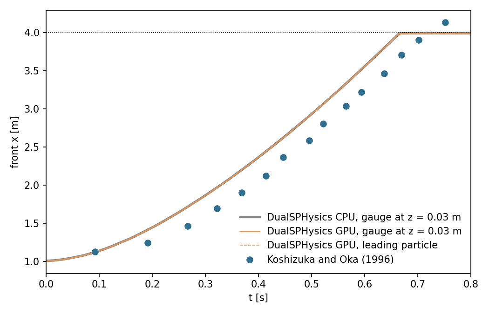
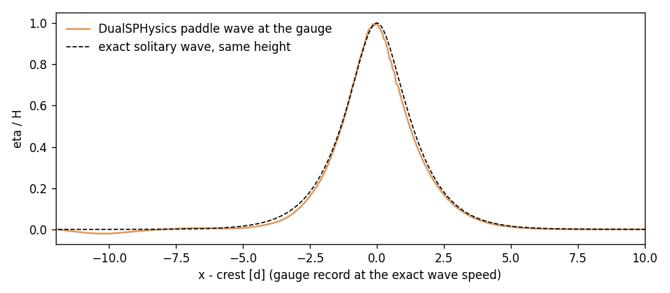
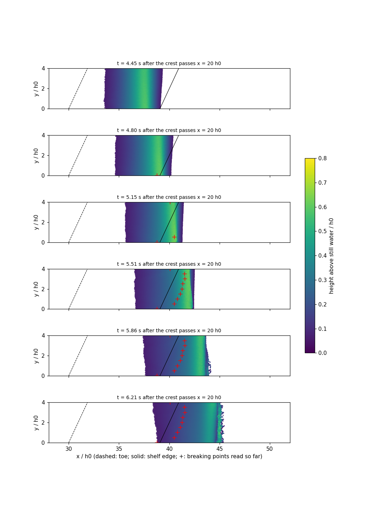

# DualSPHysics Reference Runs

pySurf's breaking-wave gate cases run in DualSPHysics v5.4 (Domínguez et al. 2022), an established GPU SPH code, and measured with pySurf's own breaking tracker. The runs show how a published weakly compressible SPH code behaves on these cases at the resolutions pySurf can afford. Where both codes fail a check, the failure is likely common to the method at that resolution. Every record here is a cross-check: none validates pySurf or DualSPHysics.

DualSPHysics is not a dependency, and nothing in pySurf imports from it. The tools that wrote each case from pySurf's geometry, drove the solver in WSL and read its output back lived under `dualSphysics/` and remain in the repository's history to commit 27c0a03; `git show 27c0a03:dualSphysics/gettingStarted.md` gives the build and run guide.

## Contents

- [Records](#records)
- [The build](#the-build)
- [The scheme](#the-scheme)
- [The start: a piston tuned at a gauge](#the-start-a-piston-tuned-at-a-gauge)
- [Measuring with pySurf's tracker](#measuring-with-pysurfs-tracker)
- [The 3D cases](#the-3d-cases)
- [Results](#results)
- [Example outputs](#example-outputs)
- [References](#references)

## Records

Each JSON file holds the run's source, its case and pySurf's record of it (`record`). Times count in seconds from the crest's passage of the tuning gauge, as pySurf's count from its starting crest, with h0 = 1 m.

| File | Case | Cited by |
| --- | --- | --- |
| `grilli32.json`, `grilli64.json` | H0/h0 = 0.3 on Grilli et al.'s (1997) 1:35 beach, 2D | GPU SPH roadmap, phase 1.5 |
| `surfRanch32.json`, `surfRanch64.json`, `surfRanch128.json` | H0/h0 = 0.6 over the Surf Ranch reef, 2D: overturn at touchdown | `shoalReef.py` and `BreakingWave3D` (the 2D landing 0.55 s after pySurf's, at 32 ppd) |
| `mostert32Artificial.json`, `mostert64Artificial.json`, `mostert32Sps.json` | Mostert and Deike's (2020) 3 degree beach, 2D: energy lost in active breaking | `mostertEnergy.py --dualSphysicsSettings` (the settings) |
| `ridge25_16.json`, `ridge25_32.json`, `ridge50_32.json`, `ridge25_32CoarseBed.json` | Guyenne and Grilli's (2006) ridge, half tank, 3D | GPU SPH roadmap, phase 1.5 |
| `shoalReef32.json` | The Surf Ranch reef turned 25 degrees, 32 ppd, section by section | `shoalReef.py`, the README's 3D table |
| `shoalReef32Run.json`, `shoalReef16.json` | The same tank's run records at 32 and 16 ppd | `shoalReef32.json` |
| `reefFlat64.json` | Quiroga and Cheung's (2013) Oregon State reef flat, 2D, 64 ppd | The README's reef-flat paragraph, `reefFlatDualSphysics.mp4` |

`ridge25_32CoarseBed.json` is the earlier bed band, superseded (see [The 3D cases](#the-3d-cases)). `mostert32Sps.json` holds no share: its still tank threw particles from 1.8 s.

## The build

DualSPHysics v5.4, commit ef3721a (2025-04-16), built from the published source in WSL2 (Ubuntu 24.04) with CUDA 12.8 for compute capability 7.5, on an RTX 2070 Super (8 GB). Two settings on the make command line handle g++ 13: a compiler wrapper forces `<cstdint>` into the C++ sources, and nvcc keeps plain g++ as its host compiler. The source was not changed.

The dam break DualSPHysics ships (`CaseDambreakVal2D`) checked the build: the GPU and CPU solvers' fronts agree within 0.021 percent at all 133 gauge times (criterion 1 percent), and both lead Koshizuka and Oka's (1996) measured front by up to 17 percent (criterion 10), a steady 0.05 to 0.06 s offset from 0.19 s on that a gate taking time to lift would produce.

## The scheme

DualSPHysics's own options, fixed before the first gate run: the Wendland kernel at h = 1.5 dp, symplectic time stepping, Fourtakas density diffusion at 0.1 (`DensityDT` 2), artificial viscosity at alpha 0.01, sound speed 20 sqrt(g h0), CFL 0.2, and mDBC walls (English et al. 2022). The 2D runs keep the boundary velocity of plain DBC (`SlipMode` 1), and the 3D runs use free slip (`SlipMode` 3), so the two sets differ in their walls as well as their dimension. The energy-loss case also ran with laminar plus sub-particle-scale viscosity (`ViscoTreatment` 2; Dalrymple and Rogers 2006).

Each tank was written from pySurf's own `Bathymetry` or height field, extended flat offshore to the piston, so both codes see the same bed. The particle lattice sits half a spacing off the bed line, as pySurf's does.

## The start: a piston tuned at a gauge

GenCase cannot lay the exact solitary wave in the tank, so each case starts from a piston (`piston_solitary`, Goring's 1978 first-order theory) two half lengths and a stroke offshore of pySurf's starting crest. A free-surface gauge there reads the wave's height, less its own still-water reading at t = 0, and the tune scales the paddle's target height until the gauge reads the case's height within 2 percent. This matches the input, not the result.

At H0/h0 = 0.3 the paddle's wave matches the exact solitary wave ahead of the crest within 0.03 H at 32 ppd. At 0.6 it does not: Goring's theory is first order, and the wave at the gauge is narrow, its volume within 10 h0 of the crest 4 to 10 percent short of the exact wave's, by an amount that changes with resolution. pySurf starts the Surf Ranch case from its boundary element model's Serre wave, so the two codes' starts differ in shape as well as in method.

## Measuring with pySurf's tracker

The solver's binary Part files were read directly (within 5×10⁻⁸ m of PartVTK's CSV), their times shifted to pySurf's, and the fluid fed through `waveBreaking.BreakingTracker` set up as `BreakingWave.build` sets it, with `faceMeasure = 'contour'`. `BreakingWave.summary`'s measures and the gate criteria follow. The breaking point is the start of the face's last vertical run before the jet's touchdown, or of its longest vertical run where no touchdown is read. The energy budget subtracts a still-water run of the same tank, which settles as the wave run does, and the water the piston's stroke lifts, ρ0 g S h0² / 2.

## The 3D cases

Building in 3D took five things the 2D cases did not:

- **Normals from the geometry.** GenCase computes mDBC's normals from the particles only in 2D. The bed's came from the bed surface itself; the walls' and the paddle's from their planes.
- **A drawn bed band.** Layer m of the band is the bed surface lowered (m + 0.6 + (|dz_b/dx| + |dz_b/dy|) / 2) spacings, in triangles that rise at most 0.1 spacings. A band lowered a fixed (m + 0.6) spacings in larger triangles (`ridge25_32CoarseBed.json`) left 1.3 percent of the ridge's top row up to 0.27 spacings above the bed at 32 ppd.
- **Boxes drawn through their inner rows.** A box keeps the lattice points within half a spacing of its faces, so a wall drawn up to its plane takes the water's first row.
- **Global slip.** Version 5.4 has no symmetry plane, and its slip mode applies to every wall. The half-tank ridge's plane at y = 0 is a free-slip wall, so the bed and the other walls are free-slip too; with normals from the geometry, free slip holds the still water level within 0.003 h0.
- **Slices, not the tank.** The Part files keep two rows each side of a section for the breaking point and a layer for velocities: about 1 MB per frame at 32 ppd against 105 MB for the whole tank.

The ridge is z_b / h0 = (x - 5.225) sech²(k y) / 15 for x > 5.225, flat offshore, a wall at x = 19 h0, half the tank (0 ≤ y ≤ 4 h0), H0/h0 = 0.6; at 32 ppd it holds 3.52 million particles. The turned reef is the 2D Surf Ranch profile with its toe at x = 30 + y tan 25° across a span of 4 h0, the shelf 0.371 h0 deep running to an end wall at x = 52 h0, between free-slip side walls (the geometry of `examples/openFoam/cases/breakingWave3D`); at 32 ppd it holds 4.56 million water particles and ran in 27,327 s.

## Results

All at the scheme above; breaking points read with the rule above.

| Case | Criterion | DualSPHysics |
| --- | --- | --- |
| Grilli 1:35, 32 ppd | Hb within 10 percent of 0.476, hb within 15 of 0.345 | Hb/h0 0.355 (-25.5 percent), hb/h0 0.240 (-30.5): fails |
| Grilli 1:35, 64 ppd | The same | 0.427 (-10.4), 0.314 (-9.0): fails on Hb |
| Surf Ranch overturn, 32 ppd | Feddersen et al.'s (2024) five criteria | None pass; breaks at Hb/h0 0.586 against the boundary element model's 0.763 |
| Surf Ranch overturn, 64 ppd | The same | One passes (impact x); H -12 percent, A_O/H² -50, A_J/H² -44, theta_O +6.7 degrees |
| Surf Ranch overturn, 128 ppd | The same | Two pass (impact x, theta_O); H -12 percent, A_O/H² -35, A_J/H² -29 |
| Surface before impact, 32 to 128 ppd | Within two spacings of the boundary element model's | 0.65 h0 at every resolution: the wave breaks late |
| Mostert, 32 ppd, artificial viscosity | Share within 30 percent of 0.31 | 0.291 (-6.0 percent): passes, at 2.4 times the fit's dissipation rate |
| Mostert, 64 ppd, artificial viscosity | The same | 0.347 (+11.9): passes, at 1.6 times the fit's rate |
| Mostert, laminar plus SPS | The same | Not measurable: the still tank's thin water over the beach throws particles from 1.8 s |
| Ridge k = 0.25, 32 ppd | Breaking point; velocity | t +0.6 percent, x +0.001 h0, crest -3.5 percent; speed -8.5 percent, spanwise ratio +27: passes |
| Ridge k = 0.50, 32 ppd | Breaking point | t +2.6 percent, x +0.134 h0, crest -5.3 percent: fails on crest height |
| Oregon State reef flat, 64 ppd, CPU solver on 6 threads | Reported only | Column eta_max/H0 0.840, 0.605 and 0.400 at WG12, WG13 and WG14, against the flume's 0.608, 0.558 and 0.530 (+38, +9 and -25 percent); its wave reaches the reef edge 12 to 15 percent under pySurf's, its volume within 10 h0 of the crest 5 to 8 percent short of the exact wave's |
| Turned reef, 32 ppd | Reported only | The seven inner sections plunge 0.8 to 1.4 h0 past the shelf's edge (A_O/H² 0.12 to 0.17, theta_O 34 to 47 degrees); the break crosses the span at 9.9 m/s, 11 percent faster than c / tan 25° |

From 32 to 128 ppd the 2D overturn's shape converges and its height and timing stall: the paddle's narrow wave at H0/h0 = 0.6 likely sets the remaining error. pySurf's own results on the same cases are in [the validation README](../../README.md); its runs with DualSPHysics's settings (`mostertEnergy.py --dualSphysicsSettings`) are pySurf's scheme, not DualSPHysics.

## Example outputs

The figure is the turned reef's run from above: the crest reaches the shelf edge first at y = 0, and the breaking points (+) run across the span as the break peels. The wall sections, y = 0 and 4 h0, read breaking at the toe, artifacts of the wall rows left out of the crossing speed.

[examples/breakingWave/reefFlatDualSphysics.mp4](../../../../examples/breakingWave/reefFlatDualSphysics.mp4) sets `reefFlat64.json`'s run beside pySurf's over the Oregon State reef flat.

## References

- Dalrymple, R.A. & Rogers, B.D. (2006). Numerical modeling of water waves with the SPH method. *Coastal Eng.* 53, 141-147.
- Domínguez, J.M. et al. (2022). DualSPHysics: from fluid dynamics to multiphysics problems. *Comput. Part. Mech.* 9, 867-895.
- English, A. et al. (2022). Modified dynamic boundary conditions (mDBC) for general-purpose smoothed particle hydrodynamics (SPH): application to tank sloshing, dam break and fish pass problems. *Comput. Part. Mech.* 9, 1-15.
- Feddersen, F., Hanson, K., Mostert, W. & Fincham, A. (2024). Modelling wind-induced changes to overturning wave shape. *J. Fluid Mech.* 1000, A48.
- Goring, D.G. (1978). Tsunamis: the propagation of long waves onto a shelf. Report KH-R-38, California Institute of Technology.
- Grilli, S.T., Svendsen, I.A. & Subramanya, R. (1997). Breaking criterion and characteristics for solitary waves on slopes. *J. Waterway, Port, Coastal, Ocean Eng.* 123(3), 102-112.
- Guyenne, P. & Grilli, S.T. (2006). Numerical study of three-dimensional overturning waves in shallow water. *J. Fluid Mech.* 547, 361-388.
- Koshizuka, S. & Oka, Y. (1996). Moving-particle semi-implicit method for fragmentation of incompressible fluid. *Nucl. Sci. Eng.* 123, 421-434.
- Mostert, W. & Deike, L. (2020). Inertial energy dissipation in shallow-water breaking waves. *J. Fluid Mech.* 890, A12.
- Quiroga, P.D. & Cheung, K.F. (2013). Laboratory study of solitary-wave transformation over bed-form roughness on fringing reefs. *Coastal Eng.* 80, 35-48.
- DualSPHysics source: <https://github.com/DualSPHysics/DualSPHysics>
